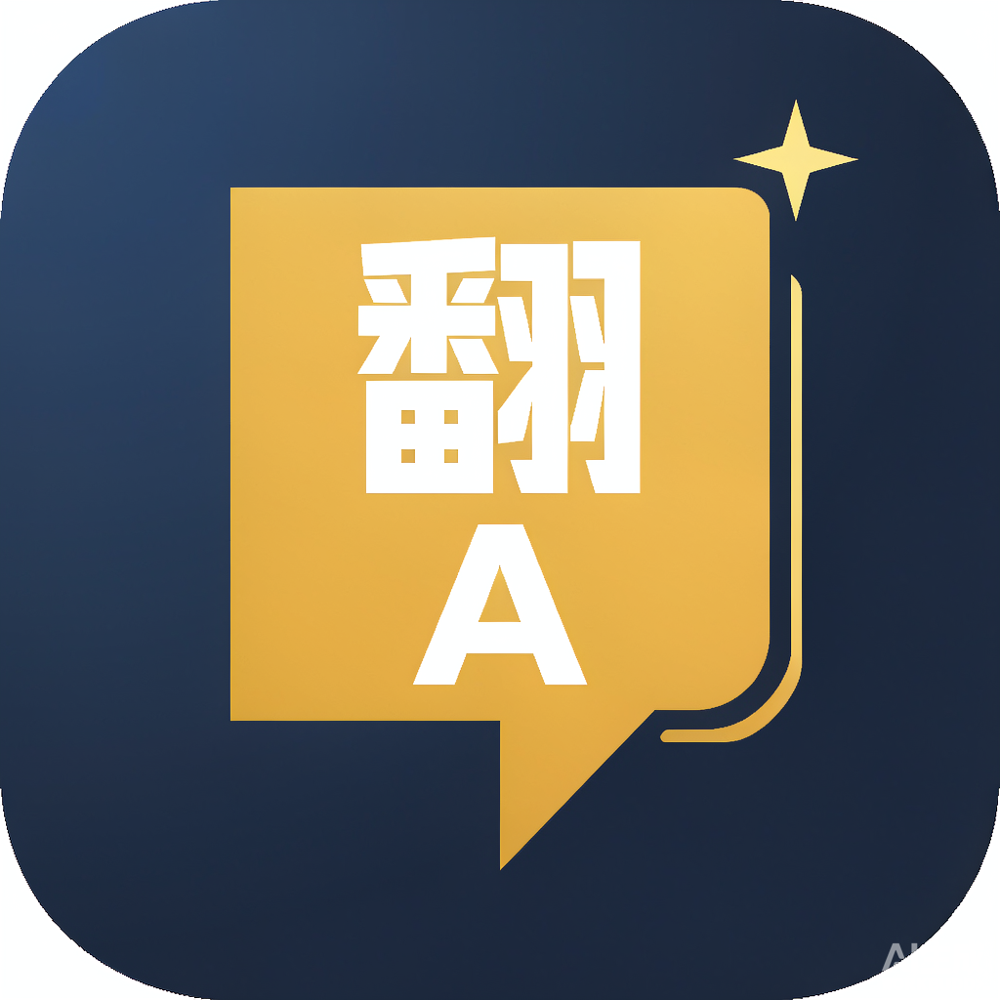

<p align="center">
  
</p>

# LOL国际服聊天框翻译

> LoL International Server Chat Translator — A desktop screenshot translation tool for League of Legends (international server) in-game chat.
>
> 一个 Windows 后台常驻的《英雄联盟》国际服游戏内聊天截图翻译工具。

<p align="center">
  <a href="https://github.com/sixjjsns/lol-chat-translator"></a>
  <a href="LICENSE"></a>
  <a href="https://www.python.org/downloads/"></a>
  
</p>

**English** | [中文](#中文说明)

---

## What is this? / 这是什么

**LoL International Server Chat Translator** is a Windows background tool that helps you understand and reply to in-game chat in real time, no matter what language your teammates or opponents are typing.

一个 Windows 后台常驻工具，让你实时看懂并回复《英雄联盟》国际服的游戏内聊天，无论队友或对手输入什么语言。

**There is currently no dedicated translation tool for the LoL international server** on the market — this project aims to fill that gap.

目前市面上还没有针对英雄联盟国际服的专用翻译工具，本项目旨在填补这一空白。

---

## Features / 功能特性

- **截图翻译 (Screenshot translation)** — 按 `F6` 截取聊天区域，视觉大模型识别并翻译，译文弹出到悬浮窗，不遮挡游戏画面。
- **反向翻译 (Reverse translation)** — 在输入框输入中文，翻译成对方语言并自动复制到剪贴板，直接 `Ctrl+V` 粘贴回游戏回击。
- **多服务支持 (Multiple providers)** — DeepSeek、OpenAI GPT、Google Gemini、xAI Grok、Moonshot Kimi，以及本地 Ollama（无需 API Key、完全离线免费）。
- **人性化滑块 (Naturalness slider)** — 拖动调节翻译「直译 ↔ 口语化」程度（映射为模型 temperature）。
- **全局快捷键 (Global hotkeys)** — 无需切出游戏，7 个动作全部可自定义。
- **译文悬浮窗 (Floating overlay)** — 无边框置顶半透明，可拖动、四角定位、双击关闭。
- **界面语言切换 (Bilingual UI)** — 中文 / English 一键切换。
- **系统托盘 (System tray)** — 后台静默运行，托盘菜单快捷操作。

---

## How it works / 工作原理

```
按下 F6（全局快捷键）         Press F6 (global hotkey)
        │
        ▼
截取聊天区域（mss 屏幕截图）  Capture chat region (mss screenshot)
        │
        ▼
图片压缩 + Base64 编码        Compress + Base64 encode image
（Pillow 降采样/JPEG 压缩，   (Pillow downsampling / JPEG
 降低 token 成本）             compression to reduce token cost)
        │
        ▼
发送给视觉大模型             Send to vision LLM
（OpenAI 兼容 Chat Completions (OpenAI-compatible Chat Completions
 API，image_url 传图）         API, pass image via image_url)
        │
        ▼
模型识别外语聊天 →           Model reads foreign chat →
意译成中文（口语化提示词     translate naturally into Chinese
 + temperature 动态调节）      (colloquial prompt + dynamic temperature)
        │
        ▼
译文弹出到悬浮窗             Translation pops up in floating overlay
（置顶、可拖动、不遮挡游戏） (always-on-top, draggable, non-blocking)
```

**关键技术点 (Key technical points)：**

1. **统一 Provider 协议 (Unified provider protocol)**：所有云服务（DeepSeek / GPT / Gemini / Grok / Kimi）和本地 Ollama 都走 OpenAI 兼容的 Chat Completions 格式，仅 `base_url` + `model` 不同，一个 `OpenAICompatProvider` 类全部适配。All cloud services and local Ollama use the OpenAI-compatible Chat Completions format, differing only in `base_url` + `model`, all adapted by a single `OpenAICompatProvider` class.

2. **视觉识别 + 翻译一体 (Vision + translation in one)**：使用支持图像输入的视觉模型（如 `deepseek-flash`、`grok-2-vision-latest`），一张截图直接完成「识别文字 + 翻译」两步，无需单独 OCR。A vision-capable model reads and translates in a single step — no separate OCR needed.

3. **意译优先的提示词工程 (Natural-first prompt engineering)**：系统提示词强调「禁止机翻、口语化、保留游戏术语（gg/mid/gank/diff）、保留语气（嘲讽/求助）」，并用反例示范，让译文更像真人玩家说话。The system prompt bans machine-style translation, favors colloquial phrasing, and preserves game slang and tone.

4. **人性化程度 = temperature (Naturalness = temperature)**：滑块 0~100 线性映射到模型 temperature 0~1.0，值越高翻译越口语化/有创造性，值越低越直译/忠实。The 0–100 slider maps linearly to temperature 0–1.0; higher = more colloquial/creative, lower = more literal/faithful.

5. **多线程安全 (Thread safety)**：Qt 信号槽 + 跨线程信号桥，keyboard 钩子（独立线程）、pystray 托盘（独立线程）、翻译任务（QThread worker）都通过信号安全回传主线程，杜绝界面卡死。Qt signals + a cross-thread bridge safely route callbacks from keyboard, pystray, and QThread workers back to the main thread — no UI freezes.

6. **缓存去重 (Cache deduplication)**：截图内容 SHA256 哈希，TTL 内相同截图直接命中缓存，避免重复请求浪费 token。Screenshots are hashed with SHA256; identical captures within the TTL hit the cache instead of wasting tokens.

7. **API Key 安全 (API key security)**：密钥单独存储（弱混淆文件），绝不写入源码、日志、配置文件，`.gitignore` 已排除。Keys are stored separately (lightly obfuscated), never in source, logs, or config, and are git-ignored.

---

## Installation / 安装

### Download / 直接下载（免安装，推荐）

前往 [Releases](https://github.com/sixjjsns/lol-chat-translator/releases) 下载最新版 `LoLChatTranslator-v1.1.0-win64.zip`，解压后双击 `LoLChatTranslator-onefile.exe` 即可运行，无需安装 Python。

Go to [Releases](https://github.com/sixjjsns/lol-chat-translator/releases), download `LoLChatTranslator-v1.1.0-win64.zip`, extract it, and double-click `LoLChatTranslator-onefile.exe` — no Python installation needed.

> Windows 可能弹出 SmartScreen 提示，点「更多信息」→「仍要运行」即可。
> Windows may show a SmartScreen warning — click "More info" → "Run anyway".

### Requirements / 环境要求

- Windows 10/11
- Python 3.11+（推荐 3.13，仅源码运行需要）
- 一个支持识图的 API Key（或本地 Ollama 实例）

### From source / 从源码运行

```bash
git clone https://github.com/sixjjsns/lol-chat-translator.git
cd lol-chat-translator
python -m venv .venv
.venv\Scripts\activate
pip install -e ".[dev]"
python -m lolchattranslator
```

### Local model (Ollama, no API key) / 本地模型（免 API Key）

```bash
ollama pull qwen2.5vl:7b
```

然后在设置里选择「本地 Ollama」即可，无需 API Key，完全离线免费。

Then select "Local Ollama" in settings — no API key required, fully offline and free.

---

## Usage / 使用

### Default hotkeys / 默认快捷键

| 快捷键 | 功能 | Action |
|--------|------|--------|
| `F6` | 截图并翻译 | Capture & translate |
| `F7` | 重新翻译 | Re-translate |
| `F8` | 复制译文 | Copy translation |
| `F9` | 选择聊天区域 | Select chat region |
| `F10` | 翻译并复制（反向翻译） | Translate & copy (reply) |
| `Home` | 显示/隐藏主窗口 | Show / hide window |
| `Esc` | 取消/关闭 | Cancel / close |

所有快捷键均可在设置页自定义。All hotkeys can be customized in the settings page.

### Quick start / 快速开始

1. 首次启动，在「设置 → 翻译服务」填入 API Key（或选择本地 Ollama），进游戏后需选择「视频 → 无边框」模式。On first launch, enter your API key in "Settings → Translation Service" (or select local Ollama); in-game, set the video mode to "Borderless".
2. 按 `F9` 框选游戏内的聊天区域（框选一次即可，之后可随时重新框选修改）。框选后只需按快捷键，不会弹出截图界面，而是直接显示结果，不影响正在运行的游戏。Press `F9` to select the chat region once (you can re-select anytime). Afterwards, pressing the hotkey shows the result directly — no screenshot window pops up, so your running game is unaffected.
3. 游戏内按 `F6` 截图翻译，译文弹出悬浮窗。Press `F6` in-game to translate; the result pops up in the overlay.
4. 想回击时，在主窗口输入框输入中文或任意语言，点「翻译并复制」（或按 `F10`），再 `Ctrl+V` 粘贴回游戏。To reply, type Chinese or any language in the input box, click "Translate & copy" (or press `F10`), then `Ctrl+V` back into the game.

---

## Supported Providers / 支持的服务

| 服务 Provider | 默认模型 Default model | API Key |
|---------------|------------------------|---------|
| DeepSeek | `deepseek-flash` | 需要 |
| OpenAI GPT | `gpt-4o-mini` | 需要 |
| Google Gemini | `gemini-2.0-flash` | 需要 |
| xAI Grok | `grok-2-vision-latest` | 需要 |
| Moonshot Kimi | `moonshot-v1-8k-vision-preview` | 需要 |
| 本地 Ollama | `qwen2.5vl:7b` | 不需要 |

---

## Configuration / 配置

配置文件保存在用户应用数据目录（Windows 为 `%APPDATA%\LoLChatTranslator\config.json`）。API Key 单独存储，绝不写入日志或提交到 git。

The config file is stored in the user's app-data directory (`%APPDATA%\LoLChatTranslator\config.json` on Windows). API keys are stored separately, never written to logs or committed to git.

---

## Development / 开发

```bash
pip install -e ".[dev]"
ruff check .
pytest
```

---

## License / 许可证

[MIT](LICENSE) © 2026 sixjjsns

---

## Disclaimer / 免责声明

本工具仅用于个人语言学习与无障碍辅助目的，不修改游戏客户端、不自动化游戏操作。请负责任地使用，并遵守游戏的服务条款。

This tool is for personal language-learning and accessibility purposes. It does
not interact with the game client or automate gameplay. Use responsibly and in
compliance with the game's terms of service.

---

## 中文说明

### 这是什么？

**LOL国际服聊天框翻译** 是一个 Windows 后台常驻工具，让你实时看懂并回复《英雄联盟》国际服的游戏内聊天。

按快捷键 → 截取聊天区域 → 发送给视觉大模型 → 译文显示在悬浮窗中。你也可以输入中文，让它翻译成对方的语言回击。

### 工作原理

详见上方「How it works / 工作原理」章节，核心流程为：**截图 → 压缩编码 → 视觉模型识别翻译 → 悬浮窗显示**。

### 功能特性

- **截图翻译**：`F6` 截取聊天区域，译文弹到悬浮窗，不遮挡游戏。
- **反向翻译**：输入中文 → 翻译成对方语言 → 自动复制，`Ctrl+V` 粘贴回击。
- **多服务支持**：DeepSeek、GPT、Gemini、Grok、Kimi、本地 Ollama。
- **人性化滑块**：调节翻译口语化 vs 直译程度。
- **全局快捷键**：7 个动作全部可自定义。
- **译文悬浮窗**：可拖动、四角定位、双击关闭。
- **界面语言切换**：中文 / English。

### 安装与使用

见上方英文「Installation / Usage」章节。

### 许可证

[MIT](LICENSE) © 2026 sixjjsns
